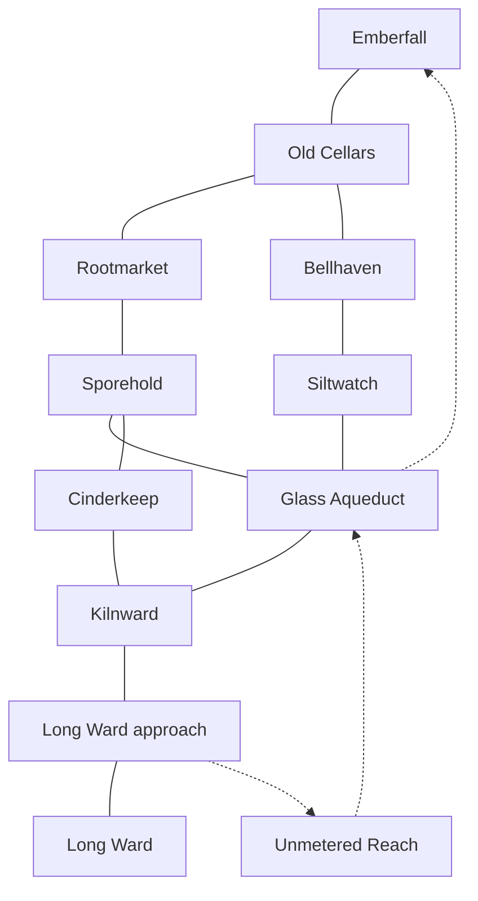

# ORRAVETH

## Exploration and campaign design

Plan for **16½ hours on the main route** and **5–7 hours of optional expeditions**.

**Every shortcut makes another road longer.**

### Starting city — Emberfall

New heroes spawn together in the **Post Court**, a public square on a dry shelf inside Emberfall’s great sinkhole. From the spawn, you can see the post office, a lantern bridge to the market, and the stair that climbs to daylight. Rain falls through the opening into a cistern below the square. An iron grating carries the noise of the cellar road up through the floor. The city is welcoming. Walk around, talk to people and meet up with your crew at the post office.

- **The post office** is the first story lead. Postmaster Dena can show you where Emberfall sits on the atlas and hand the crew its two letters. The door faces the square, so a new player can find it immediately.
- **The market bridge** gives you supplies, a repair bench and a view of the delivery ramps. The grocer keeps yesterday’s price chalked beneath today’s. Ask why it changed, and she points out which cart is still on the road.
- **The cistern gallery** has benches, a public map and a view down into the old cellars. A water keeper explains which stair you can take by pointing to the blue handrail. The party can meet here again when it returns by the aqueduct ladder.
- **The rim stair** is an optional short walk up to daylight. From the top, you can see farms around several shaft mouths and the empty stretches between them. In the evening the stair fills with growers carrying baskets down into town.

The starting city teaches movement, conversation, party pings and the atlas through ordinary interactions. Put the post office within a few steps of spawn so a ready crew can start immediately. A returning character resumes at their saved location or their last safe landing. New crew members joining during the story can regroup at the current camp or public stop after spawning in Emberfall. Keep the Post Court useful later as a supply stop, a place to compare leads and a visible record of changes to the grain and mail routes.

### The opening — Two letters for one house

Rain ticks against the cistern pipes behind Emberfall’s post office. The clerk gives your crew two letters. One is addressed to **8 Mill Stair, Emberfall**. The other is addressed to **8 Mill Stair, Orraveth**. Someone has penciled *same house* on the second envelope.

One player takes six steps from the loading yard to the Emberfall door. An older woman signs for the letter with a pen tied to a red cord. The other player follows the old address to a road gate. The brass plate puts the other door six paces away. The route counter puts it days away.

There is a speaking grille beside the road gate. Tap it and your partner hears you inside the house. The woman holds the pen up to the grille. Its red cord goes through a hole in the wall. Her sister holds the other end.

> “She gets the morning post,” the woman says. “I get the road they charge for it.”

The sisters keep an old property plan in the wall box. The plan gives you a cellar route to the first survey hinge. Later, if you establish a public crossing, the sisters can open a passage through their house. Their first act is to put the two letter slots side by side.

**What the game is about.** A co-op dungeon crawler in which the crew follows roads, changes them and finds out who relied on the old arrangement. The underground kingdoms have built food, rescue and trade around a finite supply of short routes. The crew’s adventures decide who can get home, get help or get a wagon through. The campaign ends in a fight with Chief Surveyor Veyr for control of the public hinge that can make those choices stick. Orraveth is a city whose people still have addresses on both sides of a road that was removed from the public atlas.

## 1. A world rule you can test

A survey hinge links two or more stretches of road. Each stretch has a fixed entrance and exit, a permitted range of lengths and a current length. A hinge takes paces off one stretch and puts the same number onto another stretch on that circuit. The combined length stays constant. Landmarks and rooms stay anchored. Old, unbound stairs always measure the same.

You can see the difference in the dungeon. Numbered bands on the wall move closer together or farther apart. A small circuit uses the exact number of playable steps shown in its controls. The first one switches the Market Stair and the Rescue Landing from **8 + 20** to **18 + 10**. From there, you can operate it without reading another explanation.

Large public circuits span whole regions. The atlas records their surveyed lengths, and players explore their entrances, service galleries and fixed crossings at room scale. Public road segments between named stops use illustrated journey transitions with clear travel costs and arrival points. A road that takes days in the fiction can keep a food wagon from arriving during its delivery window. Exploring it means finding a maintenance way in, boarding a scheduled ferry, or opening a side crossing.

### Three choices a hinge can create

| Situation | What moving paces changes | Why a crew might choose either side |
| --- | --- | --- |
| **A lookout can see the freight approach** | More distance means more time crossing exposed ground. The other branch shortens toward the lookout’s winch brake. | One player draws the lookout while another reaches the brake, or the crew shortens the exposed crossing and pushes through together. |
| **A ferry stops at a fixed landing** | One branch is short enough to meet the next ferry while the other approaches a dry stair and a supply shelf. | Catch the ferry and enter Bellhaven below its gate, or take the stairs and arrive with supplies for a longer detour. |
| **Two public services share a regional circuit** | A new allocation can put a delivery or rescue trip inside its operating limit and push another beyond its limit. | A party changes whose service is reliable. The preview names the affected journeys, and the next visit shows people using the result. |

Each hinge has a visible identifier and a preview. Early circuits show both ends before a change. An undiscovered end on a later circuit is labeled *unidentified*, with its direction and the amount of distance it would receive. The party can scout it before committing. Local mechanisms are reversible from fixed control rooms. Permanent public allocations happen at a scheduled trial with the affected stops and services listed.

## 2. What makes a good night of exploring

**Get a destination into someone’s head. Give them a reason to take a different way there.**

A session starts with one obvious objective and two leads you can actually follow. A dispatcher needs the stretcher road inspected. You can get there by escorting a grain cart through the western gate or following flood marks to a ferry stair. The cart captain can tell you who put the fourth stamp on her manifest. The ferry brings you past a door with that stamp on it. Each approach teaches the crew something different about the same place.

Use a rhythm of **landmark, decision, discovery, return**. At the landmark you know where you want to end up. At the decision you know one useful thing about each approach. The discovery pays off by changing your routes or your understanding of a place. On the return you use something you just found. The right reward for entering a flooded maintenance room might be a dry ladder opening beside the inn you left an hour ago.

### Make the map worth opening

- **On arrival** the atlas shows fixed boundaries, place names, waterways and the old survey’s main roads. It gives the party a sense of direction before the first dungeon room.
- **After seeing a place** the player can mark the gate, silhouette or exit they saw, with the path to it still unresolved. Example pins include *Ferry cage visible from the crypt stairs* and *Number 4 stamped on both sides of this grate*.
- **After walking a road** the atlas inks the actual connection and records its measured length. A service ladder can be inked even when the official map calls the street a dead end. If a later allocation changes the road, inspection shows its earlier and current measurements.
- **At camp** the crew can share pins and promote one to the next session’s destination. Each player keeps their own discoveries. Shared notes show who made the observation and give everyone a way to act on it.

At terminal scale, make the region outlines legible with a few strong shapes. Use line styles and glyphs for surveyed, observed and printed routes. Show the party’s notes on demand. Selecting a landmark should answer *where is it, what have we seen, and how did we get there last time?*

### Co-op that creates stories

1. **One change, two viewpoints.** One player can operate a hinge while a partner watches another road from a fixed landing. A received transfer leaves the same stamped mark at both ends. The observer can share that mark. Together they can demonstrate a link neither had established alone.
2. **Bring different things through the same place.** An unloaded scout can use the ladder into Siltwatch. The partner guiding a supply cart takes the long quay. The scout can open a fixed side gate, or meet the cart at the ferry and use a receipt found on the way. Both jobs progress the outing.
3. **Regroup through a place you recognize.** Let parties choose a fixed landmark and meet there from different approaches. The ferry cage, the return ladder and the post office should become part of the group’s spoken directions. Every story route also works solo via a fixed service loop and on-demand departures for key trials.

Reward a crew for trying a new approach with a genuinely different encounter, piece of evidence or shortcut. Later visits can vary patrols, ferry timing and what is being carried. Keep the geography learnable. An expedition can end after a small win with an unfinished lead saved in the atlas.

## 3. The political map

Three sovereign powers share the surveyed roads. Each has a capital or market that benefits from the current system, and another city whose people can point to what it costs.

| Power | Cities | What you can see before anyone explains the dispute |
| --- | --- | --- |
| **Orchard Crown** | **Rootmarket** sells produce from illuminated terraces. **Sporehold** keeps those terraces alive from bridges braced into the roots. | At the Rootmarket gate, export wagons get the shortest road. Follow a grower home and you see the clinic bell still ringing across a walk that takes half a day. The Crown offers to guarantee the clinic route if it gets the freight vote. Sporehold’s crews ask to see the guarantee on the hinge itself. |
| **Bell Houses** | **Bellhaven** dispatches rescue crews from a vertical ferry cage. **Siltwatch** keeps boats in shallow flood channels. | A Bellhaven dispatcher chooses a road for a stretcher. Siltwatch’s crew reaches the patient first and has to wait on the steps because its landing is unlicensed. Bellhaven’s flood shelters really do save lives. Siltwatch wants the right to run the routes it already knows. |
| **Iron Compact** | **Cinderkeep** casts replacement hinges. **Kilnward** maintains and calibrates them. | Cinderkeep’s newest parts fit every public drawing. At Kilnward, you see a mechanic file a fourth notch by hand. The Compact wants a common standard. Its own fitters disagree about whether the drawings should include every road the machines affect. |

Emberfall is the free city built around the sinkhole mouth. Its cheaper imports and quick cellar road are both products of the arrangement. The first mayor you meet can show you the winter she used the freight reserve to keep her city supplied. At the start of the game, she sends the survey crew below because the latest maintenance invoice bills Emberfall for a road the atlas says does not exist.

### Why the cities grew underground

On the plateau above Emberfall, most rain runs into cracks in the rock. There are farms and little surface villages where the soil holds water, especially near the rim. The deepest reliable springs, the large dry shelves and the seams people mine are all below. During lean years, families began building near the springs and carrying grain down from the sunny mouths. The first permanent districts grew where a dry shelf had a water supply, room for a market and two ways to reach daylight. Later generations built roads among those districts. A village that moved back to the surface would have to replace the cisterns, sheltered storage, workshops and freight connections it already used every day.

The underground has its own limits. People grow grain and most vegetables on sunlit rim farms and in terraces below broad openings. The darker farms grow fungi on hauled straw and spent mash. Bellhaven gets fish from its channels. Food moves along routes the player can see and walk. Homes sit above old flood marks. Foundries need dedicated draft shafts, so the hottest work takes place at Cinderkeep instead of spreading through every district. People at the lowest stops mark the time by work bells. Growers and surface carriers bring daylight news down with the mail.

Show these reasons at street level. Emberfall’s cistern fills while the plateau is dry. At Rootmarket, a worker pays for a sack of straw before harvesting a tray of mushrooms. In the crypts, a painted flood line runs across the bottom of a family’s former doorway. The family now lives a flight of steps higher. Later, when the crew sees the original survey plans, they recognize the water marks and ventilation openings as the fixed landmarks that made the cities possible.

### Friendly streets and hostile ground

**Most cities are safe to explore.** Emberfall, Rootmarket, Sporehold, Bellhaven, Siltwatch and Kilnward have welcoming public districts. In those streets the crew walks, talks to NPCs, visits shops and workshops, listens to local disagreements and finds routes. Guards give directions or explain local rules. There are no roaming combat encounters in these spaces. A closed pier can make Bellhaven feel strict while its public streets are still friendly.

**An enemy-held gate or district announces itself.** Show lowered bars, a posted order and a guard challenge at the boundary. Mark the controlled approach on the atlas once the party sees it. Veyr’s office places Cinderkeep’s foundry gate under an armed closure after the crew requests the old mould. The crew fights trained guards at a shield line and on a loading balcony. Workers can show a freight gallery that puts the crew on the balcony side of the same fight. When the guards retreat or yield, the crew can walk through and talk to the fitters. The homes and workers’ stair remain civilian spaces.

**The roads between cities hold different kinds of threats.** At the disused tollworks below Rootmarket, an armed goblin salvage gang has seized a narrow stretch it used to maintain. Its leader Tern is collecting food to hold the works through winter after the freight lease cut the gang out. The gang warns people off at a striped gate, then fights anyone who pushes through. Scouts use drain culverts and ladders to attack from the side, giving the party a reason to watch both levels. In Siltwatch, goblin boatwrights and rescue crews live and work openly alongside their neighbors. One of their foremen can tell the party how to reach the tollworks from the high path. Hostility follows the group holding the road and what the crew does at its gate.

| Where you walk | What you see and who you meet | What a visit can teach you |
| --- | --- | --- |
| **Emberfall** · welcoming starting city | A wet lantern bridge over the cistern. Dena weighs mail and calls across the square to a grower bringing in the first baskets. | The post office and market stand only a few steps apart. A second official address can still send you down an entirely different road. |
| **Rootmarket** · welcoming | Sunlight cuts across the upper terraces. The scale keeper waits for straw deliveries before opening the mushroom stalls. | Ask her to show you the route on a receipt, then follow the cart groove to a second gate. The prices at the two gates explain why growers argue over the freight lease. |
| **Sporehold** · welcoming | Rope bridges connect homes in the roots. A clinic worker changes shoes at the door because she has just crossed a wet service stair. | She can walk with you to the short route the workers use. Follow where the handrail ends to find the approach to the clinic and the lower road to Cinderkeep. |
| **Bellhaven** · welcoming, with a controlled rescue pier | The ferry cage drops past a row of flood marks. Iven runs dispatch from a booth where a stretcher is hung vertically to keep the path clear. | Ask why two bells rang for the same call. Follow the dispatch board down the dry stair and compare where each crew started timing. |
| **Siltwatch** · welcoming | People hang boat hooks above their doors. Goblin boatwright Nemi listens for hollow boards with the handle of a hammer, then calls the tide depth to the ferry crew. | Go with Nemi to the pier the old survey missed. The flood mark and the boat’s draft tell you when the channel is usable. |
| **Cinderkeep** · hostile at the foundry gate during the closure | Bright furnace slits show through the barricade. Outside the gate a shift worker waits with lunch wrapped in cloth while the guards search tool carts. | Talk to the worker to learn the yard layout, then fight the guards from the main road or flank their shield line from the freight gallery. The confrontation is over access to the works. The casting floor beyond it is staffed by people you can question. |
| **Kilnward** · welcoming | Shift bells travel through the handrail. Apprentice Pela holds a lamp behind a fitted hinge to show a name filed on its inside face. | Follow the marks to the repair crew’s room. They can show the party where to stand for the live transfer test. |
| **Long Ward** · welcoming residential streets | Two rows of identical house numbers face different approaches. Mera keeps a lamp beside the toll register even when no one crosses that day. | Walk an address list with her. The same number belongs to a family that has lived there through two changes to the border. |

Use town visits to give players one person worth remembering, a place they can point to and a lead they can follow on foot. Keep conversations short enough to fit around walking. Let the crew return later and see what a new route changed. If the workshop opens, show a worker taking the first cart through it. If a gate remains shut, show where the queue has moved.

### Customs the crew can encounter in play

In **Sporehold**, a market receipt includes the route the seller promised to use. Deliver a crate by the freight road and the receipt identifies the lease that kept it short. Bring it up the workers’ stairs and the recipient can enter a different route on the same receipt. Both are genuine, and the difference matters at the public trial.

In **Bellhaven**, rescuers cut one notch in a brass tag when they receive the call and another when they reach the patient. In Siltwatch, the boat crew puts its first notch on the tag at the house that raised the alarm. Find two tags with the same name and the two start points explain a discrepancy players can test.

In **Kilnward**, fitters mark the fixed end of a new hinge with their own name before anybody is allowed to load it. Some names appear only on the inside face. Looking at the back of a machine can tell you which apprentice had to make an unapproved repair, and which workshop door to knock on.

### Three people with a stake

- **Mera**, who keeps the old tollhouse, signs each day’s bridge count although some days the count is zero. Her sister lives at the other address from the opening. Mera asks the crew to prove someone can make the return journey before she lets the council declare the road restored. She has seen ceremonies for routes she still cannot use.
- **Iven**, a Bellhaven dispatcher, first helps you take a stretcher through the dry crypt stair. He keeps a copy of the rescue tag from the day his brother died. The record says the Houses responded within the limit. The alarm sat at the far end of a lengthened road before his dispatch clock began. Iven wants a fair measurement and a route his next crew can actually use.
- **Sera Dain**, a Kilnward fitter, filed the fourth notch into replacement parts because the official drawing would have jammed the mechanism. She signed the drawing anyway. When the crew publishes its measurements, she has to choose between defending her signature and describing exactly what she did. Her practical advice can get you into a gallery that most legislators have never visited.

### Chief Surveyor Veyr

Veyr was a child in Rootmarket when the relief wagons came through during the winter collapse. He can name the street where a baker split the first sack of flour between six households. Years later, as chief surveyor, he signed the three-branch drawing and quietly directed fitters to keep the fourth socket working. His office renews the emergency allocation every year. He knows exactly which road absorbs the cost.

Give him three appearances before the finale. In Act I, he takes his coat off to help the crew unload a delayed cart. His signature on the delivery receipt matches the name on the road lease. In Act II, Sera shows you his signed three-branch drawing, and he warns you in person that some towns have built their only usable freight approaches around his arrangement. In Act III, the party demonstrates alternative freight and rescue routes. Veyr attends and checks the results himself. He orders the fitters to close the approach to the main hinge as the public trial is announced. He will accept a different schedule only while his office keeps the power to revoke it.

## 4. Ten regions you can recognize from the doorway

| Region | Landmark and local route choice | What you can carry forward |
| --- | --- | --- |
| **Old Cellars** | One market hatch overlooks both loading lanes. Follow the barrel grooves or use a dry service loop past the first hinge. | A hand-marked property plan and your first measured transfer. |
| **Fungal Caverns** | Rootmarket’s stacked beds glow in bands. Ride the produce ramp with a delivery or trace the irrigation handrails around the queue. | An export manifest stamped for a branch missing from your atlas. |
| **Rootwood** | Sporehold’s root bridges creak as loads pass. Follow workers’ tool marks below the public walkway to find their clinic approach. | A fixed lower road to the foundries and a witness to who pays for the harvest route. |
| **Sunken Crypts** | Bellhaven’s ferry cage drops past old brass water marks. Use a higher funeral stair or descend to the rescue ramp when its gate opens. | A stretcher route the crew can demonstrate later and a view of the far pier. |
| **Silt Marsh** | Painted high-water lines end at a pier hidden from the city gate. Test a narrow boat crossing or take the more exposed dyke. | A ferry stop inside Bellhaven’s wall and proof of where a rescue call actually began. |
| **Glass Aqueduct** | A wall of transparent conduits separates the public spans from the service galleries. Reach the winch brake from a gallery or cross the freight approach. | The matching end of an old transfer stamp and a ladder back to Emberfall. |
| **Cinder Foundries** | Casting moulds cool in rows. Compare the fourth socket on the old pattern with the three on the new one. | The ability to identify the missing branch on later machinery, plus a different way into Kilnward. |
| **Counterweight Fields** | Loaded frames rise like a row of houses outside Kilnward. Walk fixed platforms to watch a known transfer arrive at the hidden receiver. | A witnessed measurement the crew can use to challenge the public survey. |
| **Unmetered Reach** | Old stairs climb through rock with no survey stamps. Find the bypass and test its steepest crossing with a loaded cart. | A viable fixed foot route and proof of its limits. Its flood shelter becomes a midway stop if the crew establishes public access. |
| **Long Ward** | The same house numbers recur across an immense approach. Follow addresses on the old plan to occupied stoops, school windows and the tollhouse. | The road’s true endpoints, a public proposal and a way to reconnect two districts the crew has already come to know. |

The map has three loops players can learn. The early cities loop through the aqueduct. The two industrial cities loop back through Sporehold. The Reach gives the Long Ward a fixed return route. The dotted routes are discoveries, with the aqueduct ladder available in the first expedition and the Reach opened later.

## 5. The story the crew can prove

### What actually happened

**Forty-three years ago**, a roof fall closed two food roads before winter. Orraveth operated the first public survey circuit. Its council agreed to take extra paces onto its bridge approach so the other cities could shorten their roads and get food through. The emergency contract was to expire after a relief crew made a public trip across both banks. The two banks recorded the names of everyone who made the last pre-collapse crossing. Mera was on the list as a child.

**After the winter**, the receiving cities kept their quicker freight roads. Warehouses, rescue depots and tax districts grew around them. Orraveth’s eastern councillors accepted annexation by Bellhaven so they could get a dispatcher and a clinic on their side of the bridge. The western bank joined Emberfall’s market district later. It gave households cheaper food and stopped them electing anyone who could represent the city as a whole. The relief trip that could end the contract still required a single crew to depart from and arrive in Orraveth. After the redraw, the forms no longer recognized either address as part of Orraveth.

**The physical receipt survived.** The original machines stamp the sending and receiving branches when a transfer completes. Before the redraw, both districts could prove exactly which public road took the paces. The new atlas had three listed branches. Mechanics still cast the fourth socket in the field because the working machine needed it. There is one set of books for the road people pay for and another for the road the rock actually carries.

**The present crisis** starts when the Compact tries to replace a regional hinge with a part cast from the official drawing. The fourth branch binds. Sera had filed a fourth notch in the old part. The new part goes in straight from the mould and fails during a market delivery at the start of the game. A calibration latch opens an old observation landing. For the first time in years, a crew can watch the fourth branch receive distance while the city representatives watch the sending ends.

### Four discoveries and how they play

| What the crew learns | What they do with their hands | What opens afterwards |
| --- | --- | --- |
| **The atlas has two addresses for the same house.** | Deliver the first letter, follow the second road, and answer the same speaking grille from both sides. A solo player can hear the response from either end. | The sisters’ cellar plan and access to the first hinge. |
| **A fourth branch still receives paces.** | Find the four-socket mould or witness a transfer from the maintenance landing. Compare the receiver’s stamped mark with a sender’s. | A reason to visit the Long Ward and a way to identify its old service gallery. The crew can witness a live transfer when it reaches Kilnward. |
| **The relief contract can still expire.** | Compare the tollhouse register with the newer dispatch record. Run a trial with Iven and time the journey from the actual call. | An alternative rescue route and the argument for a new public crossing. |
| **The bypass changes who can afford the fix.** | Walk the Reach, test its steepest ramp with a cart, and visit the shelter during a spill. | A viable proposal for pedestrians with an explicit freight and maintenance cost. |

Each conclusion has more than one lead. A party can reach the Long Ward before it finds the mould. Let the tollkeeper show the old route in person, then give the crew a reason to recognize the fourth socket later. The campaign record keeps what the party observed alongside what a witness claims. It advances when the crew has grounds for its next action.

### The Public Walk leads to the final boss

The old relief contract calls for one crew to cross both banks. The party convenes the first such trial in decades. Its members can carry a letter, guide a stretcher, or walk a loaded cart to a named stop. Citizens are waiting at both ends. Prove the proposal by physically completing the routes. Each trial leg ends at a fixed landing. Together they establish the proposed route and give the crew a valid claim to enter the chamber below the tollhouse.

At the second landing, Veyr invokes his emergency override. He holds the public roads at their last allocation and takes the brass counterseal down to the proving chamber, where fitters test the hinge before changing public routes. Mera keeps the trial register open. The crew follows Veyr into the chamber through the service entrance it surveyed earlier. **The crew must fight and defeat Veyr to release the override, commit any public allocation, and complete the campaign.** Every proposal leads to the same confrontation, with different approaches available when the party enters.

### Final boss — Chief Surveyor Veyr

A fixed central span connects four landings. The proving chamber has its own small circuit, separate from the public roads, with two movable approaches. Veyr locks himself into a survey frame that can operate the circuit and drive an iron ram. The frame looks like the equipment the crew saw Sera repair at Kilnward. On the floor, the sender and receiver stamps light up as a pair before each transfer. The terminal marks threatened tiles and gives each stamp a distinct shape. Transfers only affect clear moving stretches. If a stretch is occupied, Veyr charges along the current layout with its own marked warning. Fixed landings always give the crew a place to read the next move.

| Phase | What Veyr does | How the crew beats him |
| --- | --- | --- |
| **1. Close the approach** | Veyr shortens the lane he is facing, stretches the opposite lane and charges down the shortened path. The paired stamps and the ram’s direction appear before the charge. | Dodge onto a fixed landing, take the outside stair and hit the frame while the ram retracts. An ally can bait the charge to bring Veyr past the other player’s landing. |
| **2. Break the feed** | At two-thirds health, the frame locks onto two feed sockets. Veyr alternates charges while the active socket powers his guard. | Pull a fixed service brake while his ram is stuck at the far end, then attack the exposed socket. Repeat on the other side. A solo player can reach either brake by the short maintenance stair during the same recovery window. Breaking the feeds opens Veyr to damage for the final phase. |
| **3. Hold the center** | Once both feeds are broken and Veyr reaches one-third health, he abandons the damaged frame and fights on the central span. He can trigger short ram sweeps from the remaining brake lever and rush across the span after each sweep. | Read the floor marks, cross on the recovery and finish him with the party’s combat abilities. Teams can divide the two approaches. A solo player can circle using the outer landing. Veyr’s defeat releases the override and leaves the crew the counterseal. |

The trial determines one starting advantage. The restored street gives the crew the near-bank stairs. The rescue and freight proposal gives them the cart shield they staged during the trial. The bypass lets them enter from an upper service landing. Each entry leads into all three combat phases. Set a checkpoint at the chamber door after the trial. On a wipe, reset the fight and its local circuit so the party can retry from that checkpoint. Tune a successful attempt to roughly **8–12 minutes**, with the chapter budget also allowing time to learn the fight and recover.

### Commit the road plan after the fight

Once Veyr is defeated, the crew and the witnesses return to the public controls. The crew uses the counterseal to commit the proposal it tested. Mera enters the completed crossing in the public register. The party walks back through the changed district and delivers the letters under the new arrangement.

The public hinge governs four corridors with **120 total units of surveyed length**. These figures are a design model for balancing the finale. The atlas translates the totals into travel times and names affected stops. The working service targets are freight at or below 20, rescue at or below 16, maintenance at or below 28, and a shared Orraveth street at or below 24. Those four targets add up to 88. The remaining 32 units must be absorbed somewhere in the circuit, so every available plan exceeds at least one service target.

| Proposal | Freight / rescue / maintenance / Orraveth | What players see after choosing it |
| --- | --- | --- |
| **Current arrangement** | 12 / 12 / 18 / 78 | The freight and rescue routes run easily. The old city’s shared street is still an expedition. |
| **Reopen the city street** | 32 / 16 / 48 / 24 | Neighbors share a street again. Freight begins to break its loads at the market gate, and maintenance crews open a shelter midway along their new commute. |
| **Guarantee rescue and freight** | 20 / 12 / 44 / 44 | Rescue dispatch becomes public, and food keeps arriving on time. Orraveth gets a local crossing at the house and separate services on each bank. The longer maintenance approach is borne by the crews whose work keeps the circuit running. |
| **Establish a fixed public bypass** | 20 / 16 / 28 / 56 | The Reach carries people between the banks while the main bridge stays long. The new foot route closes periodically during spills, and heavy loads still need a transfer at the slope. Find shelter, local crews and the fixed way through before proposing it. |

Show the changed city through a return walk. A restored market is one specific woman setting up a stall on the far bank for the first time. A maintained freight guarantee is a real cart arriving while a fitter packs an overnight bag. The crew sees the results of the compromise it was willing to make.

## 6. The 16½-hour campaign

A new co-op pair should take about **16 hours 30 minutes** to complete the main story. The budget includes the opening, the journey across all ten regions, the choice of public road plan, the mandatory fight with Veyr and a playable epilogue. Optional expeditions add **5–7 hours**, for a **21½–23½-hour** target with every expedition. These are design budgets to check with playtests. The main route assumes ordinary navigation, a few recoveries and time to discuss choices. It stands on its own at a level and equipment pace set by the story encounters.

### Act I — Learn to read the roads · 4h 30m

| Chapter | Main-route budget | Playable beats and what they open |
| --- | ---: | --- |
| **1. Two Letters** · Emberfall, Old Cellars, Glass Aqueduct | **30 min** | **5 min** spawn in Emberfall’s Post Court, collect the letters and use the grille. **7 min** test the first hinge. **10 min** walk through either welcoming gate district and fight at the winch outside town. **8 min** inspect the fourth stamp and open the ladder back to the post office. The stamp is evidence of an unknown destination. The crew leaves with two leads and a way back. |
| **2. What a Sack Costs** · Fungal Caverns and Rootmarket | **75 min** | **20 min** meet the scale keeper and trace a shipment through the illuminated terraces. **30 min** take the cart past the goblin-held tollworks outside town, with a high foot route for a scout. **25 min** use the dispatch board and delivery receipts to reach the growers’ side of the market. The crew sees the same shipment priced differently at two stops and opens the western service road. |
| **3. The Bell That Started Late** · Sunken Crypts, Bellhaven and Silt Marsh | **90 min** | **25 min** trace the ferry cage from the funeral stair to the lower pier. **40 min** answer a spill alarm outside the residential streets, clear the dry landing and guide a stretcher or signal a boat crew. **25 min** walk the route between the two alarm points with Iven and compare the tags. The party charts a ferry stop inside Bellhaven’s gate. |
| **4. The Clinic Road** · Rootwood and Sporehold | **75 min** | **20 min** follow the growers’ tool marks below the public bridges. **35 min** cross the root span and help reopen the approach to the clinic while the freight road stays in use. **20 min** carry the first supply crate down the fixed lower steps. The crew opens the route to Cinderkeep and leaves Sporehold with a usable local connection. |

Chapters 2 and 3 can be tackled in either order. The Rootwood chapter can start after Rootmarket. Both western and eastern findings give the crew a reason to inspect the foundry together at the end of Act I. Each side’s key fact has a short alternative lead at a public stop if a party takes an unexpected route through its chapter. The crew needs to understand where the disputed road affects food and rescue. The campaign record advances when they observe the effect or follow a witness to it.

**The Act I turn.** At Rootmarket, the short road makes someone’s livelihood possible. At Bellhaven, the same machinery can quietly move the start of a rescue clock. The crew learns what a regional change costs by walking two routes whose signs tell different stories.

### Act II — Find the fourth road · 6h

| Chapter | Main-route budget | Playable beats and what they open |
| --- | ---: | --- |
| **5. The Fourth Socket** · Cinder Foundries and Cinderkeep | **85 min** | **25 min** reach Cinderkeep from Sporehold and talk to the waiting shift workers. **35 min** fight through the guard closure, entering from the foundry gate or flanking the guards from the freight gallery. **25 min** cross the working floor, inspect the old mould with Sera and take the workers’ lift into Kilnward. The party gains a way to recognize a concealed receiver by its casting marks. |
| **6. A Receipt at Both Ends** · Counterweight Fields and Kilnward | **90 min** | **25 min** walk the service platforms and calibrate the test marker. **40 min** watch a live transfer from two vantage points and reach the loaded platform when it jams. **25 min** carry matching impressions to the fitter’s room and reopen the field stair to the aqueduct. The crew establishes where branch four leads by following the receiver line. |
| **7. The Winter That Stayed** · Glass Aqueduct and emergency store galleries | **85 min** | **20 min** use the new stair to enter the aqueduct from above the winch. **35 min** get through the emergency stores as their crews reroute freight during a spill. **30 min** compare the current dispatch marks with the temporary winter schedule. The party finds the trial clause and opens the old calibration road toward the Long Ward. |
| **8. The Houses Beyond the Gate** · Long Ward and its tollhouse | **100 min** | **30 min** descend past the old bridge signs and find the western stoops. **40 min** use the surveyed service gallery to reach the far bank and return by the old school stair. **30 min** walk both address lists with Mera and register the route the crew actually took. The party can now visit both banks directly from fixed stops and can explain why the old contract stayed in force. |

**The Act II turn.** At the mould, the fourth socket looks like a repair. In the field, it becomes a measurable destination. In the Long Ward, it turns into a neighborhood. Show the original relief workers’ names at a fixed rest point on the approach. One is on a street sign the crew already passed on the other bank.

**The signature co-op sequence.** During Chapter 6, one player reaches the fixed sender gallery and can read the next permitted transfer. Another watches the receiver through the counterweight frames. The receiver’s stone bands start to move as the crew crosses between safe platforms. The two sides stamp the same transfer number. If the players stick together or play solo, the machine retains the impression at each end and a maintenance loop connects the galleries. Both roles still get a meaningful encounter and a clear view of what changed.

### Act III — Decide who gets the short road · 6h

| Chapter | Main-route budget | Playable beats and what they open |
| --- | ---: | --- |
| **9. A Road of Its Own** · Unmetered Reach | **90 min** | **25 min** survey the fixed stair and choose a route past the first flooded break. **40 min** test the ridge with a load, then find shelter during a spill. **25 min** reach the aqueduct from the far end and mark which parts a pedestrian, stretcher and cart can use. The crew earns a fixed return path and can credibly propose a public foot bypass. |
| **10. Two Banks, One Roll** · Long Ward, Siltwatch and Bellhaven | **95 min** | **25 min** trace the two old addresses into the new dispatch districts. **40 min** run Iven’s stretcher trial from the house that raises the alarm, using either the boat route or the fixed dry stair. **30 min** bring a witness and both timing tags to the tollhouse via the crew’s own route. This proves what an official response time measured and establishes a workable rescue plan for the finale. |
| **11. The Last Short Delivery** · Rootmarket, Cinderkeep and the aqueduct works | **75 min** | **20 min** arrange where a divided load can transfer and observe the queue before the trial. **35 min** escort a maintenance crew through the hostile aqueduct works while it replaces a failing stop on the regional hinge. **20 min** use the fixed exits to check the provisional route changes, then choose which public proposal to test. The crew has seen the likely cost on the ground before committing. |
| **12. The Public Walk** · Both banks of Orraveth and the proving chamber | **100 min** | **15 min** inspect the proposal and muster at the tollhouse. **25 min** complete two linked trial legs with the same registered crew. **15 min** follow Veyr through the service entrance after he invokes the override. **25 min** learn and clear the mandatory three-phase fight. **20 min** commit the result and return to 8 Mill Stair to deliver the letters. |

The twelve chapters total **990 minutes**. The finale’s three proposals share the muster, one crossing objective and the required fight with Veyr. Each has a distinct route and final service test. The street restoration demonstrates access to both banks, the rescue and freight agreement demonstrates two operating windows, and the fixed bypass demonstrates a crossing on foot with freight transferred at the slope. In a solo trial, one surveyed journey is enough to establish each leg’s timing, and a local crew handles the other end of a paired load. A co-op party can assign partners to scouting, carrying and confirming the endpoint without requiring a specific class.

**The last scene belongs to a place the crew knows.** If the sisters can put their two slots side by side, they do it while you stand at the grille. Under the bypass plan, Mera gets to walk to the second slot from the new foot route. If the crew guarantees separate services, the first carrier asks which route to write on the receipt. The final atlas shows the charter that was adopted, the roads that changed and the access the crew proved by walking them.

### Six optional expeditions · 5–7h total

Each is a **50–70 minute** outing with its own destination and a lasting payoff. They unlock from things players see on the main route. The story’s necessary proof, core tools and route choices are available within the main chapters.

| Expedition | When it becomes visible | What players find or change |
| --- | --- | --- |
| **Mail for a Closed Door** | After the second address, once the western service road is charted | Follow a bundle of undelivered addresses across three short, recognizable routes. One resident is listed under two names on the same doorstep. The crew can open a small postal loop and see the delivered mail in the epilogue. |
| **After the Last Cart** | At Rootmarket’s dispatch board in Act I | Follow the short freight road after the market closes and reach a terrace whose growers refuse the export lease. Carry tools up their foot route and open a permanent supply stop above Sporehold. |
| **The Boat They Can’t License** | After meeting Siltwatch’s rescuers | Test an unlisted channel in two water conditions and get a boat through a gate visible since Chapter 3. A new ferry stop gives the party another way into the crypts. |
| **Sera’s Name** | When the crew finds the old mould | Follow a fitter’s stamp on the back of three machines to a sealed workshop. Bring a working part out through the loading floor and unlock a second foundry approach used by maintenance crews. |
| **A Night in the Reach** | After locating the shelter in Chapter 9 | Trace a longer trail above the spill line and bring supplies to two shelter doors. The trail offers a slower crossing when the main foot route is closed. |
| **The Third Key** | After the crew first reaches both banks of the Long Ward | Follow three households’ claims to the same school door. Find the building’s fixed rear entrance and reconnect it to the school stair. Return to see a room shared by children from both banks. |

### Party progression across a full campaign

| Stage | What changes about exploration | What the party can use |
| --- | --- | --- |
| **Hours 0–4½** | Read a rough map, recognize fixed landmarks and test local routes. | The first hinge, the atlas with player pins, the aqueduct ladder and the ferry stop. |
| **Hours 4½–10½** | Prove which roads share a circuit. Recognize the same equipment and stamps in places with competing accounts of the past. | The fitter’s gauge identifies paired stamps, fixed maintenance routes connect the industrial cities, and the crew can enter the Long Ward from two sides. |
| **Hours 10½–16½** | Test which routes work for a particular load. Reuse earlier journeys to demonstrate a proposal under public scrutiny. | The fixed bypass survey, tested freight and rescue alternatives, and authority to commit a public allocation after the trial. |

Exploration tools are available to every hero in the crew. Existing combat classes can solve the same encounter differently through positioning and abilities. Offer gear sidegrades through chapter rewards and optional routes. A pair that sticks to the main story should reach the finale equipped to clear it.

### Sessions, checkpoints and travel

- Put a fixed stopping point after every major beat, generally **20–40 minutes** into an outing. At the end of a chapter, leave a return path or a public stop with the next lead nearby. Parties can stop after one chapter or play two in a longer evening.
- The host’s world keeps opened roads, district control, public decisions and chapter progress. Heroes keep personal atlas observations. At a camp, a late-joining friend can accept the current crew briefing and use the physical routes the crew has opened. Checkpoints retain the last completed trial leg if somebody disconnects.
- Reuse a familiar location when a new entrance, an altered allocation or a fresh piece of evidence gives the journey a purpose. After a successful discovery, open the safe route back from the destination side. Trips between already established public stops can be summarized with the destination and travel cost shown before departure.
- A failed freight or rescue leg resumes from the last fixed landing with a recoverable load. The rest of a chapter remains completed. Call story ferries on demand, resume at completed checkpoints and award enough experience along the main route for its encounters.

### Build and test it at campaign scale

**First 30 minutes.** Ship the chapter prototype described below and test it with fresh pairs. Confirm that they can explain the two addresses, predict a transfer and use the shortcut home without directions.

**First 4½ hours.** Build the four Act I chapters as a continuous campaign. Reuse the aqueduct, the market hatch and the ferry cage across multiple approaches. Test both chapter orders, a straight story path and a solo run before building the industrial half.

**First full clear.** Build Acts II and III around the main set pieces, the three finale proposals and Veyr’s proving chamber. Prototype the local circuit, the phase transitions and the door checkpoint together. Test solo and co-op clears with each trial approach before tuning damage or recovery windows. A chapter typically needs three substantial playable beats, one distinctive destination, one map change and a place to resume. Reuse authored spaces across acts when they have a new function, such as the aqueduct becoming a test site after it served as a crossing. Develop optional expeditions once the main route stands on its own.

**Measure the right time.** Record active play, required travel, retries and optional detours separately for fresh co-op pairs. Use **15+ hours for a typical first main-story clear** as the pacing target and **16½ hours** as the content budget. Watch for chapters that fall short because the route choice is obvious, and chapters that run long because players cannot find an actionable lead. Adjust the encounters and map cues based on what happened. Check that crews using different routes still reach the same necessary conclusions and that the finale takes meaningfully different routes under different proposals. Verify that every proposal requires Veyr’s defeat, wipes retain the completed trial, and victory enables the public controls exactly once.

## 7. First expedition to build

**25–35 minutes for a new two-player party.** One circuit, two city gate districts, one co-op encounter, one return shortcut. Six to eight memorable rooms around the shared links. Use the full campaign map as the atlas’s old survey and make the early region boundaries and walkable roads visible from the beginning.

| Beat | What players do | What must land |
| --- | --- | --- |
| **0–5 min — The post** | Spawn together in the Post Court, walk to Dena at the post office, take both envelopes and use the grille. | Players can find the post office and explain why they want to see the far door. |
| **5–12 min — The first hinge** | Find the numbered bands on each approach. Choose 8/20 or 18/10. Watch the other end from a fixed landing. | They predict which road lengthens and understand why a partner might care. |
| **12–22 min — Two city gates** | Follow the grain carrier west or the bell runner east. Rejoin at the aqueduct. A co-op crew can split and bring back two pieces of information. | Each approach offers a different practical advantage and a clue the other crew can use. |
| **22–30 min — The winch** | Cross the exposed span, or reach the service brake and disable the winch. Read the stamp in the inspection gallery. | A route choice changes the encounter. Players can point to the fourth stamp and explain why it matters. |
| **30–35 min — The way home** | Open the aqueduct ladder, walk it back to the post office and pin one next lead. | The party can direct someone back to the aqueduct without a quest arrow. |

### Two approaches to the winch encounter

The freight road puts the crew at the front of the aqueduct, in view of the winch. A cart brought through the short Market Stair can be parked in a marked recess as movable cover. The rescue landing puts the crew behind a grille with a sightline to the brake. With the landing shortened, the runner reaches it in time to show the crew the access latch. A party that splits can use the cover on one side and the brake on the other. Parties arriving by a single route can cross in cover or take fixed service steps to reach the brake on their own.

Stage the cart and runner at the fixed ends when their routes are longer. If players discover the alternate service steps first, they can still reach the grate and find the stamp. Keep one strong use for each approach and make it visible before the crew enters the dangerous room.

### Build order and scope

1. **Walkable route graph.** Author the Emberfall spawn, friendly Post Court, approaches, gate districts and aqueduct. Put the first combat encounter beyond the city boundary. Give rooms, corridors, landings and landmarks stable IDs. Walk both ways round the loop before decorating it.
2. **First hinge.** Give the local circuit two states with atomic movement and matching endpoint feedback. Run the same walkthrough with two clients and solo. Expose the current and proposed road lengths to both players.
3. **Atlas and memory.** Add printed, observed and walked routes, shared pins and one shortcut. Save discovery and shortcut state. Reconnect both players at different fixed landings and make sure the same world allocation appears for each.
4. **Story and co-op encounter.** Add the letters, the two local NPC journeys, the brake and the fourth stamp. Verify that the party can reach and interpret the stamp from either approach.
5. **Campaign expansion.** Build the industrial loop and the Long Ward only after the early loop is worth replaying. Extend authored public states and evidence paths one region at a time. Seed minor encounters and side caves once the fixed landmarks are in place.

### Implementation decisions that protect the feel

- The server owns the circuit state and commits paired changes in one operation. A commit checks the state revision and verifies the movable stretches are clear. Players, carts, enemies and loot keep valid positions. Fixed landings provide a predictable place to wait, regroup and reconnect.
- Each region has a stable escape path. Shared-world changes keep both endpoints valid. Local switches can be operated from the return loop. Endgame allocation previews identify impact on shared roads and require a deliberate crew decision.
- Use existing movement, combat, pings and saves as the starting point for implementation. Add one authored world loop alongside the current procedural content so the expedition can be playtested as a distinct entry point. Reuse route and world code where the two modes share behavior.
- Author the major landmarks, their lines of sight and their alternative approaches. Put randomness into optional encounters and supplies where a crew can enjoy a different outing while its mental map still works.

### What to watch in a blind playtest

Observe fresh pairs before explaining the premise. Ask them to mark where they think the far door is. At the first hinge, look for one player warning the other about the road that will lengthen. Watch whether both paths to the aqueduct get used across different pairs. Check that players recognize the welcoming gate districts, and that they see the guard or tollworks challenge before entering hostile ground. After the winch encounter, ask them what their partner noticed that they did not. End by asking them to pick one lead for the next outing and show how to get back to its starting point.

If players swap the hinge and then take the same route in both states, change the encounter geometry. If they read the atlas correctly but cannot recognize the ferry, strengthen its silhouette and repeat it from a useful angle. If the fourth stamp only makes sense after a speech, put its matching half on a road they have already walked. If both players follow the most confident navigator silently, give the second player a fixed vantage with information that can change the route decision.
